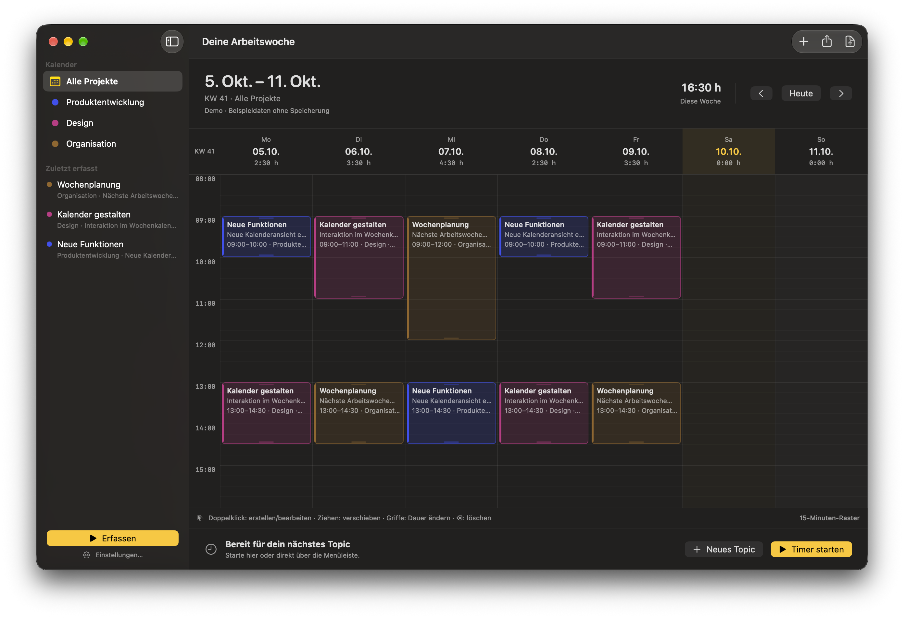
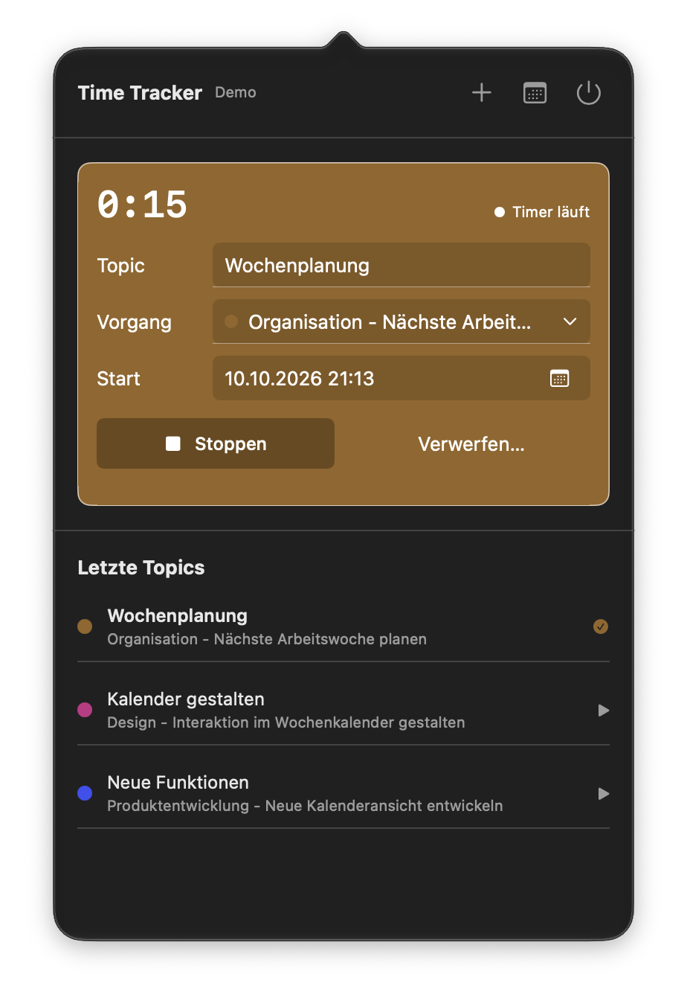

# Time Tracker

A native macOS time tracker with a weekly calendar, chronological and topic-grouped lists, and quick capture in the menu bar.

## Distribution

Download the latest version from [GitHub Releases](https://github.com/felix-lorenz/timetracker-releases/releases/latest), or install it through [felix-lorenz/homebrew-tap](https://github.com/felix-lorenz/homebrew-tap).

This repository provides product documentation, release notes, distribution archives, and support through GitHub Issues. The source repository is private.

## Features

- Start tracking immediately, with optional booking text, project, and a locally maintained Jira issue.
- Start, switch, and stop timers from the main window or menu bar. Delete entries from the calendar, list, or editor, or discard a running timer. Entries shorter than 60 seconds are removed immediately; entries of 60 seconds or longer require confirmation. The threshold uses the complete booking's precise duration. Cancel, Return, and Escape keep the entry; confirmation deletes only the unchanged requested entry.
- Review time in a weekly calendar with daily totals, including entries that cross midnight. Open a calendar entry for editing immediately on a single click; a double-click keeps the same editor open. Double-click empty calendar space to create an entry. Create and edit entries in a separate movable project-colored card; Settings and menu-bar capture remain usable. Edit a running entry's details and start time without stopping it.
- Hover over a calendar entry for half a second to see booking text, project, local issue name, local start/end times, total duration, running state, and available import evidence. Details appear beside the day column without covering it and preserve keyboard focus. Times use `HH:mm`; the duration covers the complete booking even across midnight or daylight-saving changes. Details disappear on exit, scrolling, clicking, or dragging. Very long text may be explicitly shortened to fit; open the editor for the complete booking text.
- Switch between the weekly calendar and list views, sharing week navigation, project filtering, captured totals, exports, and the running timer. The chronological list shows collapsible days and individual intervals; the topic view groups each day by exact booking text, project, and local issue, with independently editable intervals and summed durations. Topic groups start collapsed; expand individual groups to inspect their intervals. Expansion resets when changing the week or project, and newly appearing groups remain collapsed.
- See unrecorded pauses of at least one minute between bookings in the unfiltered chronological list. Shorter gaps are hidden without changing existing entries or captured totals. Overlapping or touching entries do not create false gaps, and pauses do not count toward captured totals. Choose **Zeit erfassen** to create a completed entry with the exact pause boundaries; partial capture leaves any remaining gaps of at least one minute visible, and canceling leaves records and the running timer unchanged.
- Reuse topics from the newest 100 time entries by start time, deduplicated by exact booking text, project, and local issue. Editing or deleting a record updates this history immediately; no separate topic templates are maintained.
- Manage topics from all stored entries in Settings → Topics. Search by booking text, project, or local issue, then rename every entry with the same exact text/project/issue combination, including historical and running entries. The app previews merges with an existing group. IDs, assignments, and time boundaries are preserved; ordinary entry editing still changes only that entry.
- When starting without a running timer, a free gap shorter than one minute after the latest completed booking is assigned to the new capture, across all projects. Completed bookings are unchanged; gaps of one minute or longer and manual entry creation or editing are unaffected.
- Clock times use `HH:mm`; completed durations and totals use `H:mm h`, with `< 1 min` for positive durations below one minute. Running timers always show elapsed seconds (`m:ss` below one hour, then `h:mm:ss`). Precise stored durations are summed before displaying complete minutes; CSV and Tempo retain their existing precision and rounding rules.
- Preselect the latest booking's optional local issue and its project for new capture, and restore the source entry's assignments when choosing a topic suggestion.
- Start a new topic immediately in a movable capture card or through menu-bar Plus, with a focused Topic field and the latest optional project and issue. Closing the card keeps its timer running. Menu-bar Plus and unassigned capture keep the popover open for editing; unassigned capture starts without a project or issue. The popover has a fixed header and a scrollable body containing the timer card and recent topics. It retains its combined project/issue selector and native Liquid Glass background.
- Apply valid day selections and complete time input immediately in separate calendar panels. Existing entries save field edits automatically; backfilled entries remain drafts until explicitly created.
- Floating capture, edit, and backfill cards close on outside clicks or when switching to another app. Pending entry edits use the same save behavior as closing with X, uncreated drafts are discarded, and running timers continue. Inside Time Tracker, the first outside click closes the card; a second click operates the target. A click in another app closes the card and reaches that app normally. Calendar, issue, and topic-suggestion panels remain part of the card.
- Use a shared project palette with hue-preserving, contrast-adjusted brightness and consistent saturation, plus white menu-bar text.
- Configure the menu-bar display in Settings → General: set a daily work target from 1 minute to 24 hours (8 hours by default), hide the progress fill, or disable topic scrolling. These preferences are saved locally and take effect immediately.
- Show or hide the menu-bar icon in Settings → General. The preference is saved and defaults to visible. Hiding it closes quick capture and disables its menu command and ⌘⇧T shortcut; active timers continue.
- Optionally start Time Tracker at login from Settings → General. A login launch opens in the menu bar without showing the calendar or Dock icon; opening the weekly calendar restores the normal window.
- The Topic field grows to show multiline text, and suggestions disappear when no previous entry matches.
- Manage projects, local issues, and the Tempo Cloud connection in Settings. Local issues can use a label without a Jira key; their project determines the color and filter for assigned bookings. A local issue label replaces the Jira title and key in entry forms, dropdowns, suggestions, calendar/list details, accessibility, menu-bar displays, and Tempo preview/status messages. Without a local label, ordinary issue names prefer the Jira title and use the key only when no readable name exists; Tempo retains its key fallback. Settings shows the local label, Jira key, and remote title separately. Open Settings from the application menu or with **⌘,**. Changing an issue's project updates its existing bookings, including the running timer, while retaining entry IDs, booking text, and time boundaries.
- Search Jira Cloud by exact issue key, title text, or an optional JQL filter, then adopt selected issues locally. Reloading refreshes the Jira key and title while retaining the local label and project; issues from different Jira sites stay separate. Search and local adoption do not create or modify remote Jira tickets.
- Remove an issue's Jira link while retaining its local label, project, and booking assignments.
- Keep tracking records locally, with atomic saves and a backup of the previous valid snapshot.
- Export completed records as a neutral CSV, including the local issue label and an empty Jira key for unlinked issues.
- Preview, export, and transfer worklogs through the optional Tempo Cloud connection, with a local journal to prevent duplicate in-app transfers. Manage the connection in Settings → Tempo Cloud, also accessible from the import dialog.

The current interface is German. Local tracking does not require a Jira connection, Homebrew, or API tokens. Maintaining an issue locally does not create it in Jira.

The neutral CSV is **not a verified Tempo import format**. Tempo Cloud requires the user's own Jira and Tempo credentials and assigns worklogs to that user's account. Every transferred worklog requires exactly one locally maintained issue with a valid Jira link. Bookings without an issue or Jira link remain blocked while valid bookings can be imported. Live Tempo transfer and access permissions remain acceptance checks; development validation uses mocked HTTP and isolated demo data.

Tempo combines completed bookings with the same exact booking text, Jira issue, required attributes, and day in the author's Jira profile time zone. Captured durations are summed before each worklog is rounded to the nearest 15 minutes, with halfway values rounded up and a minimum of 15 minutes. Worklogs transfer their date and duration without the captured start time. Local records remain unchanged. Eligible worklogs can be adjusted in 15-minute steps before transfer, with a 15-minute minimum. Daily and selection totals, details, JSON export, and transfer use the adjusted import duration. Adjustments apply only to the current preview and reset when it is closed, reloaded, or invalidated.

Choose the week and project filter in the main calendar before opening Tempo. The dialog shows the selected calendar week and date range before loading; opening it makes no network requests. Completed bookings overlapping the selected week are included in full and split at midnight in the author's Jira profile time zone. After preparation, the dialog shows the actual Tempo lookup range and explains any dates extending beyond the selected week.

The movable, resizable Tempo preview blocks only the calendar window that opened it; Settings and available menu-bar quick capture remain usable. Its width fits the displayed columns and available screen width, without horizontal scrolling. Closing and Escape are disabled during checks or transfer. Worklogs are grouped into collapsible days. Each day has a native checkbox with unchecked, mixed, and checked states: clicking an unchecked or mixed day selects all eligible groups, while clicking a checked day deselects them. Individual selection remains available. Imported and blocked groups stay excluded, and selection is locked during checks or transfer. Day headings remain left-aligned at the same width when expanded or collapsed; collapsing preserves the selection. Daily totals show captured time and the sum of adjusted import durations without rounding the total again. JSON export and import use that same selection; deselected worklogs are omitted, and both actions are disabled when nothing importable is selected.

Before an import, a running timer overlapping the selected local calendar week and matching the project filter prompts you to continue or cancel. It remains excluded and keeps running. Canceling creates no reservation and sends nothing; the app checks again before the first transfer.

Confirmed imports add a small sync symbol to preview rows and calendar cards, including every source booking of grouped worklogs. The symbol is a historical import receipt for at least one day portion, not a current comparison with Tempo. Its tooltip and accessibility label include the worklog ID and Jira site. The marker remains after closing the dialog, restarting the app, or editing a local booking. Pending or rejected outcomes and JSON export alone do not create a success marker. Demo receipts are labeled “Import simuliert”.

If Tempo already contains a worklog for your own account on a day, all new worklogs for that day initially start deselected, regardless of issue or project. A day warning explains this, and additional worklogs can be selected manually. The app checks again before the first transfer; newly occupied days are deselected and the entire run stops before sending or reserving any worklogs, leaving the preview open for review.

Required Tempo work attributes appear as immutable per-ticket preview columns. This version automatically reads a required Tempo Account from the Jira issue and resolves its account key through Tempo. This requires Accounts read access in addition to Worklogs Manage access. Missing or unavailable defaults, including other required attribute types, block the affected bookings while valid groups remain importable. Tempo validates Account applicability during transmission; acceptance in the intended installation remains a live check.

## Screenshots



Time Tracker 0.8.0 — weekly calendar in an isolated demo view.



Time Tracker 0.8.0 — menu bar popover in an isolated demo view.

## Requirements

- macOS 27 (Golden Gate) or later
- Apple Silicon (arm64)
- Homebrew only for installation through the Homebrew cask; direct ZIP installation does not require Homebrew

Distribution builds use Developer ID Application signing, Hardened Runtime, and Apple notarization. Runtime checks on another Mac remain a separate acceptance check.

## Installation and updates

### Direct download

1. Download the ZIP asset from the [latest release](https://github.com/felix-lorenz/timetracker-releases/releases/latest).
2. Extract the archive and move `Time Tracker.app` to `/Applications`.
3. Open Time Tracker from Applications.

To update, quit Time Tracker before replacing the app with the latest download. Quitting preserves an active timer; stop it first if you want tracking to end.

### Homebrew

Install [Homebrew](https://brew.sh), then run:

```sh
brew tap felix-lorenz/tap
brew install --cask felix-lorenz/tap/timetracker
```

To update, quit Time Tracker and run:

```sh
brew update
brew upgrade --cask felix-lorenz/tap/timetracker
```

Quitting does not stop an active timer. Installation and updates preserve local tracking records and the Tempo import journal.

## Data and credentials

Tracking records and the Tempo import journal are stored in `~/Library/Application Support/Time Tracker/`. Jira and Tempo tokens are stored in the macOS login Keychain. Back up the tracking file and import journal together; the journal records transfers that must not be repeated.

Version 0.5.0 upgrades schemas 1–4 in memory to schema 5, which derives topics from entries and stores each local issue's optional Jira link and project. A unique existing project is retained; issues previously used in multiple projects require an explicit choice in Settings before changes can be saved. That choice applies to all bookings assigned to the issue. Entry IDs, booking text, and time boundaries are preserved, and bookings without an issue keep their project. Loading alone leaves the file unchanged; the first successful change or completed conflict resolution saves the upgraded format and backs up the original file. Older app versions cannot read the upgraded tracking file.

Replacing the development build with a Developer ID signed build may require reauthorizing or re-entering the saved connection credentials. Installation and upgrades must preserve tracking records and the import journal.

Jira and Tempo errors are recorded in `Logs/tempo-jira-errors.jsonl` under the data folder, with rotation limited to five files of 1 MiB each. Records contain technical error metadata without tokens, booking or search text, raw URLs, or response bodies. Open the diagnostic folder from Settings → Tempo Cloud; demo logging is disabled.

## Support

Report bugs and request features through [GitHub Issues](https://github.com/felix-lorenz/timetracker-releases/issues). Include the app version, macOS version, steps to reproduce the problem, and relevant error messages. Remove personal work records, Jira details, email addresses, and all tokens from screenshots and logs before sharing them.

Time Tracker is an independent app and is not affiliated with or endorsed by Atlassian, Tempo, or Homebrew.
